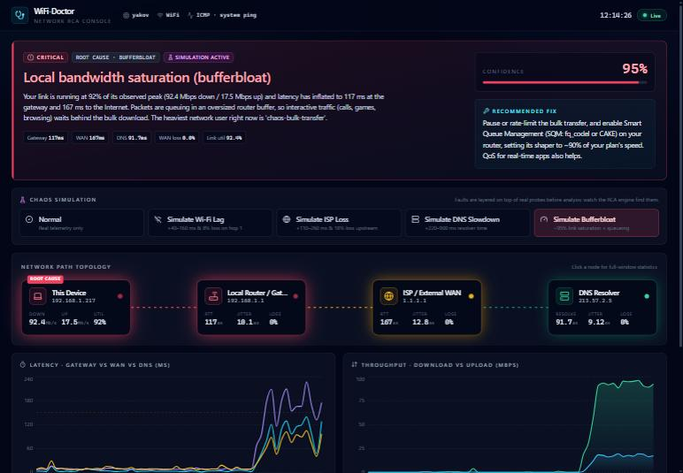
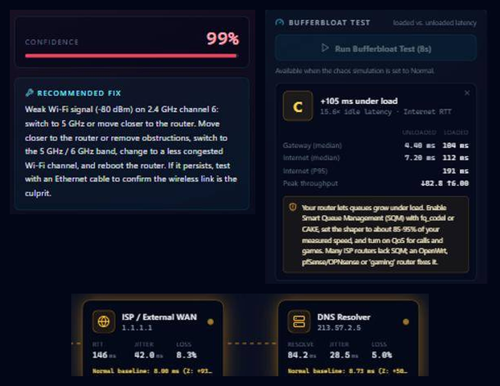
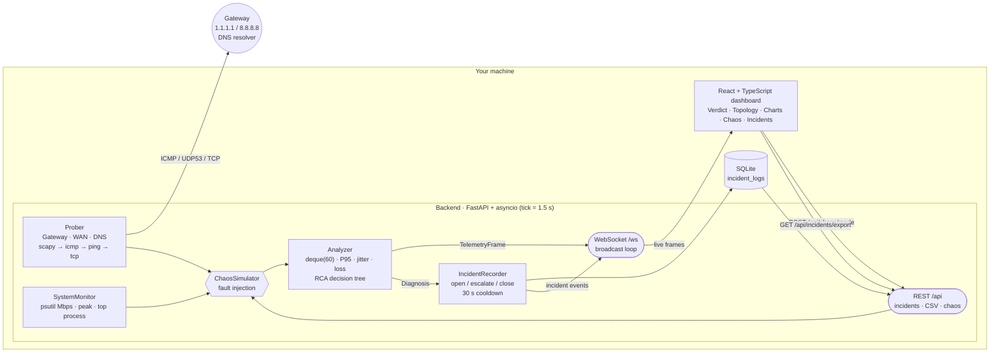

<div align="center">

# 🩺 WiFi-Doctor

**Real-time network health monitoring with automated Root Cause Analysis.**

It finds the layer where your network is failing and tells you how to fix it.

[](https://github.com/yakov-ashgar27/wifi-doctor/actions/workflows/ci.yml)


<br/>



<sub><i>Live dashboard on a home Wi-Fi network: the Bufferbloat simulation saturates the link, latency inflates on every hop, and the RCA engine names local bandwidth saturation as the root cause with 95% confidence.</i></sub>

<br/><br/>



<sub><i>v1.1 on the same laptop. Left: the recommended fix cites the measured radio (−80 dBm, 2.4 GHz channel 6). Right: a <b>real</b> 8-second load test grades the connection <b>C</b> (Internet latency 7 → 112 ms under load). Bottom: each hop shows its learned baseline and robust z-score.</i></sub>

</div>

---

## Why WiFi-Doctor?

"The Internet is slow" can mean four very different things: a weak Wi-Fi signal, a saturated uplink, a congested ISP, or a slow DNS resolver. Each one has a different fix and a different person to call.

Packet sniffers such as Wireshark show you everything and conclude nothing. WiFi-Doctor works the other way around:

| | Passive sniffers | **WiFi-Doctor** |
|---|---|---|
| Data collection | Captures existing traffic | **Actively probes** each layer of the path every 1.5 s |
| Output | Raw packet tables | **Plain-English diagnosis** + confidence score + fix |
| Correlation | Manual | Latency/jitter/loss **correlated with local bandwidth** automatically |
| Evidence | pcap files | **Timestamped incident log + CSV report** you can send to your ISP |
| Setup | Drivers, admin rights, expertise | Runs unprivileged and **never crashes** when it lacks permissions |

### Key features

- **Multi-layer active probing**: Gateway (Wi-Fi/LAN) → ISP/WAN (`1.1.1.1`, `8.8.8.8` backup) → DNS (real UDP/53 A-record queries).
- **Deterministic RCA engine** with five verdicts (`LOCAL_WIFI`, `BUFFERBLOAT`, `ISP_WAN`, `DNS_SERVER`, `HEALTHY`), each with a confidence score and remediation steps.
- **Rolling-window telemetry math** with NumPy: current, average and P95 RTT, jitter, and packet loss per hop.
- **Adaptive anomaly baselines**: a ~10-minute robust baseline per hop (median + MAD) yields a z-score, so a jump from 12 ms to 60 ms is caught on *your* network even though it is below every static threshold.
- **Physical Wi-Fi telemetry**: RSSI, band, channel, SSID and PHY rates from `netsh` (Windows, locale-tolerant), `iw` / `/proc/net/wireless` (Linux) and `airport` / `system_profiler` (macOS), used as evidence in Wi-Fi diagnoses.
- **Active Bufferbloat test**: an 8-second on-demand load test compares loaded and unloaded latency and grades your connection from A+ to F.
- **Bandwidth and process correlation** through `psutil`: live Mbps, observed peak, utilisation %, and the top network-consuming process.
- **Graceful probe degradation**: `scapy` raw ICMP → unprivileged ICMP sockets → OS `ping` → TCP handshake RTT.
- **Chaos Engineering mode** that injects realistic faults, so you can watch a full diagnosis even on a healthy network.
- **Incident log in SQLite** with a 30 s anti-spam cooldown, worst-case metric tracking and a one-click **ISP Evidence Report (CSV)**.
- **NOC-style React dashboard** with a live hop topology, synchronised charts, and a resilient WebSocket client (backoff, jitter, watchdog).

---

## Validated on a real network

The test suite is not the only evidence. WiFi-Doctor was installed on a Windows 11 laptop (Hebrew locale, 5 GHz Wi-Fi, ISP router) and every feature was run against the live network. These are the measured results, not synthetic ones:

| Check | Result on the real network |
|---|---|
| Physical Wi-Fi telemetry (`netsh`, Hebrew Windows) | SSID, **−72 to −79 dBm**, 5 GHz ch 40, 802.11ac, 97.5 Mbps PHY rate parsed correctly |
| Adaptive baselines | Learned gateway 3–4 ms, WAN 8–9 ms, DNS 9–11 ms; z-scores near 0 when healthy |
| Bufferbloat test (3 independent runs) | Grade **C** every time: +71 / +105 / +107 ms under 51–83 Mbps of load |
| All four chaos modes, switched back-to-back | 4/4 correct root cause (LOCAL_WIFI 99 %, ISP_WAN, DNS_SERVER 94 %, BUFFERBLOAT) |
| Concurrency guards | Second test → `409`, test during chaos → `409`, chaos during test → `409` |
| Incident log / ISP CSV | Self-inflicted test load creates **no** incident; "real only" export excludes all simulated rows |

The diagnosis for that laptop was consistent across every tool: a weak signal (−77 dBm) and a router without queue management. The Wi-Fi badge, the gateway latency under load and the grade all pointed to the same fix.

### Bugs that only real-world testing found

Every one of these passed CI and was caught only by running the app on real hardware. Each now has a regression test.

1. **One lost ping raised a Wi-Fi alarm.** On a weak link, 1 dropped probe in a 20-probe window is 5 %, which is over the 3 % threshold. Loss triggers now require at least 2 lost probes.
2. **Back-to-back chaos modes were misdiagnosed** (ISP loss reported as Wi-Fi), because the previous scenario's samples were still in the rolling window. Windows now reset on every mode change.
3. **The bufferbloat test logged an incident against itself,** and its loaded RTTs leaked into the "normal" baseline. Self-induced load is now excluded from incidents and baselines, and the windows are cleared when a test ends.
4. **Closing the console left the backend running,** so the next launch silently served the old version. The backend is now attached to the console window.
5. **The launcher stopped another app's processes.** It found Docker Desktop on port 8000 and killed it. The launcher now stops only its own Python/Node processes and moves to free ports when another program holds 8000 or 5173.

---

## Architecture



**Per-tick pipeline (every 1.5 s):**

1. The `Prober` runs three probes concurrently (`asyncio.gather`), each bounded by a 1 s timeout.
2. The `SystemMonitor` computes Mbps from NIC counter deltas. A worker thread refreshes the top-process scan every 3 s.
3. The `ChaosSimulator` (when enabled) layers synthetic faults on top of the real samples.
4. The `Analyzer` updates the 60-sample windows, computes statistics, and runs the RCA decision tree.
5. The frame is broadcast to every WebSocket client. The `IncidentRecorder` persists state transitions to SQLite.

---

## RCA Decision Matrix

The verdict is based on a short "recent" view: the median of the last 8 good RTTs and the loss over the last 20 probes (30 s). This lets it react within seconds without flapping on a single outlier. The dashboard still shows full 60-sample (90 s) statistics. Rules are evaluated top to bottom, and the first match wins.

| # | Layer | Trigger (thresholds) | Diagnosis | Recommended remediation |
|---|---|---|---|---|
| 0 | `LOCAL_WIFI` (CRITICAL) | 100 % WAN loss **and** gateway unreachable | Network link down | Check Wi-Fi association / cable, power-cycle router & modem |
| 1 | `BUFFERBLOAT` | (Gateway RTT **> 40 ms** OR WAN RTT **> 100 ms**) **AND** link utilisation **> 70 %** of observed peak | Local bandwidth saturation (bufferbloat) | Pause/limit the bulk transfer (top process is named), enable **SQM (fq_codel / CAKE)** at ~90 % of plan speed, QoS |
| 2 | `LOCAL_WIFI` | Gateway RTT **> 35 ms** OR gateway loss **> 3 %**, while local traffic **< 15 Mbps** | Wi-Fi signal degradation or router congestion | Move closer, switch to 5/6 GHz, change channel, reboot router, confirm with Ethernet |
| 3 | `ISP_WAN` | Gateway healthy (**< 15 ms, 0 % loss**) BUT WAN RTT **> 120 ms** OR WAN loss **> 3 %** | ISP backbone congestion or upstream routing issue | Power-cycle modem/ONT, check ISP status page, **export ISP Evidence Report** and open a ticket |
| 4 | `DNS_SERVER` | Gateway & WAN healthy BUT DNS resolution **> 150 ms** OR failing (> 3 % timeouts) | Slow / unresponsive DNS resolver | Switch to `1.1.1.1` / `8.8.8.8` on the device or router DHCP |
| 5 | `NONE` | All layers within thresholds | All network layers healthy | No action needed |

**Severity:** `CRITICAL` when loss is ≥ 10 % or latency exceeds the critical threshold for that hop (Gateway 100 ms · WAN 300 ms · DNS 500 ms). Otherwise `WARNING`.

**Confidence score (0–99):** combines *how far* the metrics exceed their thresholds, *how cleanly* the other layers isolate the fault (for example, a clean gateway raises confidence in an ISP verdict), and *how many samples* support it. Weaker fallback branches (such as a degraded gateway under moderate load) are scored lower on purpose.

### Adaptive baselines (hybrid triggering)

Static thresholds remain the hard guardrails. In addition, every hop keeps a rolling buffer of its last **400 good samples** (`BASELINE_WINDOW_SIZE`, ~10 min). From it the analyzer computes a **robust z-score** for the recent RTT median:

```
z = (recent_median - baseline_median) / max(1.4826 × MAD, 1 ms)
```

A hop is flagged as an **anomaly** when the baseline has at least **60 samples**, **z > 3.5**, and the RTT is above a noise floor (gateway 15 ms, WAN 35 ms, DNS 45 ms). Anomalies feed the same decision tree as static breaches, add to the confidence score in proportion to z, and are reported as `WARNING` unless a static critical threshold is also crossed. Chaos-simulated samples never enter the baseline, samples taken during an anomaly are throttled (1 in 10), and the baseline resets when the gateway or resolver changes. The dashboard shows *"Normal baseline: 12 ms (Z: +8.4)"* under each hop.

### Physical-layer evidence

When `LOCAL_WIFI` fires and the radio is weak (RSSI **< −72 dBm**) or on **2.4 GHz**, the diagnosis cites it directly: *"Weak Wi-Fi signal (−78 dBm) on 2.4 GHz channel 6: switch to 5 GHz or move closer to the router."* The confidence score also rises, because the physical measurement backs up the latency evidence. On Windows 11 24H2+, `netsh` needs **Location services** turned on to report Wi-Fi details; without them the dashboard says so, and the RCA uses latency only.

### Bufferbloat grade

| Latency increase under load | < 5 ms | < 30 ms | < 60 ms | < 200 ms | < 400 ms | ≥ 400 ms |
|---|---|---|---|---|---|---|
| **Grade** | A+ | A | B | C | D | F |

Grades C–F include an SQM/QoS recommendation. The test runs 3 streaming downloads and 1 upload against Cloudflare's speed-test endpoints (with fallbacks) for 8 s while the prober keeps measuring. Only one test can run at a time (HTTP **409** otherwise, also while a chaos simulation is active), and a 10 s watchdog aborts any test that overruns.

**Edge cases handled:**

- A gateway that never answers ICMP while the Internet works is treated as *filtering probes*, not as a fault.
- Peak bandwidth has a 10 Mbps floor, so an idle machine never looks "saturated".
- If ICMP is silently filtered on the network but UDP/DNS works, the prober switches itself to TCP-handshake RTT.

Every threshold lives in [`backend/app/config.py`](backend/app/config.py), and each one can be overridden with an environment variable (for example `GATEWAY_WARN_MS=50`).

---

## Quickstart

### Option A: Docker Compose (one command)

```bash
git clone https://github.com/yakov-ashgar27/wifi-doctor.git
cd wifi-doctor
docker compose up --build
```

- Dashboard: **http://localhost:3000**
- API docs (Swagger): **http://localhost:8000/docs**

> **Networking note:** with the default bridge network, *Hop 1* measures the Docker bridge gateway rather than your Wi-Fi router. On **Linux**, use the host-network override to diagnose your real Wi-Fi:
>
> ```bash
> docker compose -f docker-compose.yml -f docker-compose.host.yml up --build
> ```
>
> On Docker Desktop (macOS/Windows), run the backend locally (Option B) for true Wi-Fi diagnostics, or set `GATEWAY_IP=<your router>` in `docker-compose.yml`.

### Option B: Local execution

**Requirements:** Python **3.13** and Node.js **20+**.

**Linux / macOS**

```bash
./scripts/run_local.sh            # unprivileged: icmp_dgram / ping fallback
sudo ./scripts/run_local.sh       # optional: enables scapy raw-socket ICMP
```

**Windows: one click**

Double-click **`scripts\run_local.bat`**. The launcher:

- installs Python and Node.js with `winget` if they are missing
- creates the virtualenv and installs dependencies
- picks free ports if another app (such as a Docker project) holds 8000 or 5173
- opens the dashboard

Keep its window open; closing it stops WiFi-Doctor.

```powershell
# equivalent from a PowerShell prompt
powershell -ExecutionPolicy Bypass -File .\scripts\run_local.ps1
```

> On Windows, scapy needs [Npcap](https://npcap.com/) and an Administrator shell. Without them, WiFi-Doctor automatically uses `ping.exe` and keeps measuring real latency. On Windows 11 24H2+, turn on **Location services** so `netsh` can report Wi-Fi signal details.

**Manual setup**

```bash
# Terminal 1: backend
cd backend
python -m venv .venv && source .venv/bin/activate   # Windows: .venv\Scripts\activate
pip install -r requirements.txt
uvicorn app.main:app --host 127.0.0.1 --port 8000

# Terminal 2: frontend
cd frontend
npm install
npm run dev          # http://localhost:5173 (proxies /api and /ws to :8000)
```

### Try the RCA engine in 10 seconds

1. Open the dashboard and wait for the verdict to read **All network layers healthy**.
2. Click **Simulate ISP Loss**. Within a few ticks the WAN node turns red, the latency chart spikes, and the verdict becomes **ISP backbone congestion** with high confidence.
3. Click **Normal**. The incident closes in the history table with its duration and worst-case metrics.
4. Click **Download ISP Evidence Report (CSV)**.
5. With the simulation on **Normal**, click **Run Bufferbloat Test (8s)** to grade your real connection under load.
6. Try **Simulate Wi-Fi Lag**. The gateway badge switches to a weak 2.4 GHz signal, and the diagnosis cites the physical evidence.

Simulated incidents are flagged (🧪 in the UI, `simulated=yes` in the CSV). Tick **Real incidents only** to keep them out of the report you send to your ISP.

---

## API reference

| Method | Endpoint | Description |
|---|---|---|
| `WS` | `/ws` | Live stream: `snapshot` (last 80 frames on connect), `telemetry` (every tick, now with per-hop `baseline_median_ms` / `z_score` and a `wifi` block), `incident` (opened/updated/closed), `chaos`, `stress_test` |
| `GET` | `/api/status` | Latest frame, network info, uptime, connected clients |
| `GET` | `/api/incidents?page=1&page_size=10&real_only=false&layer=ISP_WAN` | Paginated incident history |
| `GET` | `/api/incidents/export?real_only=true` | Streamed CSV evidence report (formula-injection safe, Excel-friendly BOM) |
| `GET` | `/api/chaos` | Current fault-injection mode |
| `POST` | `/api/chaos/{mode}` | `none` · `wifi_lag` · `isp_loss` · `dns_slowdown` · `bufferbloat` |
| `POST` | `/api/stress-test/start` | Start the 8 s bufferbloat test (`202`; `409` if one is running or chaos is active) |
| `GET` | `/api/stress-test/status` | Progress, live Mbps and the graded result |
| `GET` | `/api/health` | Liveness probe |

---

## Probe reliability (fallback chain)

| Priority | Backend | Needs | Used when |
|---|---|---|---|
| 1 | `scapy` raw ICMP | root / `CAP_NET_RAW` / Admin + Npcap | Most accurate, using kernel packet timestamps |
| 2 | `icmp_dgram` | Linux `ping_group_range` or macOS | Unprivileged ICMP sockets, no subprocess cost |
| 3 | `subprocess` | OS `ping` binary | Stock Windows; RTT parsed by a locale-tolerant regex |
| 4 | `tcp` | nothing | Locked-down containers. Times the TCP handshake (SYN→SYN/ACK **or RST**) |

Capabilities are detected at startup. If a backend starts failing at runtime (for example, permissions are revoked), the prober **demotes itself** to the next backend instead of crashing. DNS timing never needs privileges because it sends a hand-built DNS packet over a normal UDP socket.

---

## Project structure

```
wifi-doctor/
├── backend/
│   ├── app/
│   │   ├── main.py              # FastAPI entrypoint, CORS, lifespan, /ws endpoint
│   │   ├── service.py           # Real-time pipeline + WebSocket broadcast loop
│   │   ├── config.py            # Thresholds, probe targets, window sizes (env-overridable)
│   │   ├── database.py          # Async SQLAlchemy + aiosqlite
│   │   ├── models.py            # IncidentLog ORM + Pydantic schemas
│   │   ├── engine/
│   │   │   ├── prober.py        # Multi-layer prober with fallback chain
│   │   │   ├── system_monitor.py# Mbps, NIC detection, top process
│   │   │   ├── analyzer.py      # Rolling stats + RCA decision engine
│   │   │   ├── simulator.py     # Chaos / fault injection
│   │   │   ├── recorder.py      # Incident lifecycle → SQLite
│   │   │   ├── wifi_stats.py    # RSSI / band / channel parsers (netsh, iw, macOS)
│   │   │   └── stress_test.py   # Active loaded-vs-unloaded latency test
│   │   └── routers/
│   │       ├── incidents.py     # History + CSV export
│   │       └── control.py       # Chaos control + status
│   ├── tests/test_rca.py        # Deterministic RCA + chaos tests
│   ├── tests/test_new_features.py # z-score, Wi-Fi parsers, bufferbloat grading, 409 guard
│   ├── requirements.txt
│   └── Dockerfile
├── frontend/
│   ├── src/
│   │   ├── components/          # Header, VerdictBanner, TopologyMap, TelemetryCharts,
│   │   │                        # ChaosControls, IncidentTable
│   │   ├── hooks/useTelemetry.ts# Resilient WebSocket hook
│   │   ├── types/telemetry.ts   # Strict payload types
│   │   └── lib/                 # API client + formatters
│   ├── nginx.conf
│   └── Dockerfile
├── scripts/                     # run_local.sh · run_local.ps1 · run_local.bat
├── docker-compose.yml
└── docker-compose.host.yml      # Linux host-network override
```

## Testing

```bash
cd backend
pip install pytest
python -m pytest -q
```

The test suite feeds synthetic probe streams into the analyzer and checks every RCA branch. It also confirms that each chaos mode is diagnosed as the correct layer with ≥ 70 % confidence. Further tests check:

- the MAD/z-score math and hybrid triggering
- the Wi-Fi parsers, against captured `netsh` (English and German), `iw`, `/proc/net/wireless` and macOS output, including the Ethernet, disconnected and Location-permission cases
- the bufferbloat grade scale, the timeout and offline paths, and the HTTP 409 concurrency guard

API tests need `pip install httpx`.

## Configuration

| Variable | Default | Purpose |
|---|---|---|
| `PROBE_INTERVAL_S` | `1.5` | Tick interval |
| `PROBE_TIMEOUT_S` | `1.0` | Per-probe timeout |
| `WAN_PRIMARY` / `WAN_BACKUP` | `1.1.1.1` / `8.8.8.8` | WAN probe targets |
| `GATEWAY_IP` / `DNS_SERVER` | auto | Override auto-detection |
| `PROBE_BACKEND` | auto | Force `scapy`, `icmp_dgram`, `subprocess` or `tcp` |
| `INCIDENT_COOLDOWN_S` | `30` | Minimum gap between new incidents |
| `BASELINE_WINDOW_SIZE` / `BASELINE_MIN_SAMPLES` | `400` / `60` | Adaptive baseline length and warm-up |
| `ZSCORE_THRESHOLD` | `3.5` | Robust z-score that counts as an anomaly |
| `WIFI_WEAK_RSSI_DBM` | `-72` | RSSI below which Wi-Fi is cited as weak |
| `STRESS_DURATION_S` / `STRESS_TIMEOUT_S` | `8` / `10` | Bufferbloat test window and hard abort |
| `DATABASE_URL` | `sqlite+aiosqlite:///./data/wifi_doctor.db` | Storage |
| `GATEWAY_WARN_MS`, `WAN_WARN_MS`, `DNS_WARN_MS`, `LOSS_WARN_PCT`, `BLOAT_UTILIZATION_PCT`, … | see `config.py` | RCA thresholds |

## Privacy

WiFi-Doctor is 100 % local. It contacts only your gateway, two public anycast resolvers (`1.1.1.1`, `8.8.8.8`) and your configured DNS server. It has no telemetry, no accounts, and no cloud.

## License

[MIT](LICENSE)
