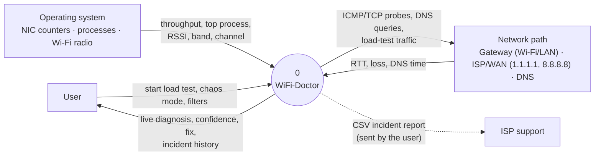
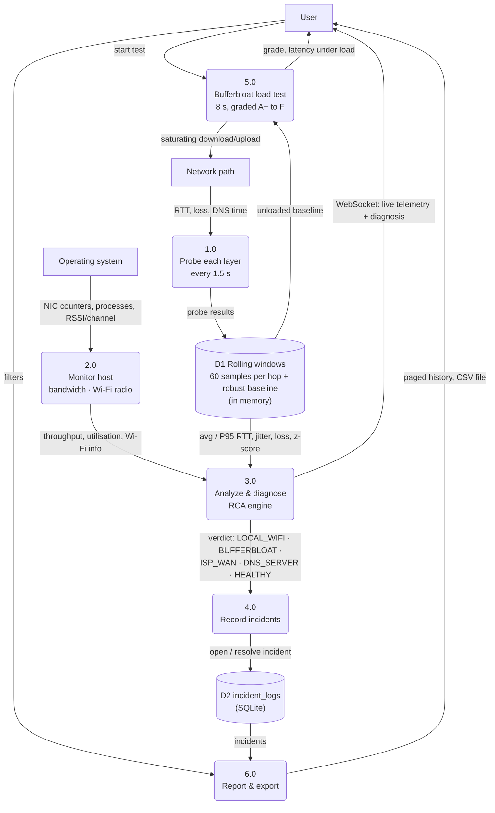
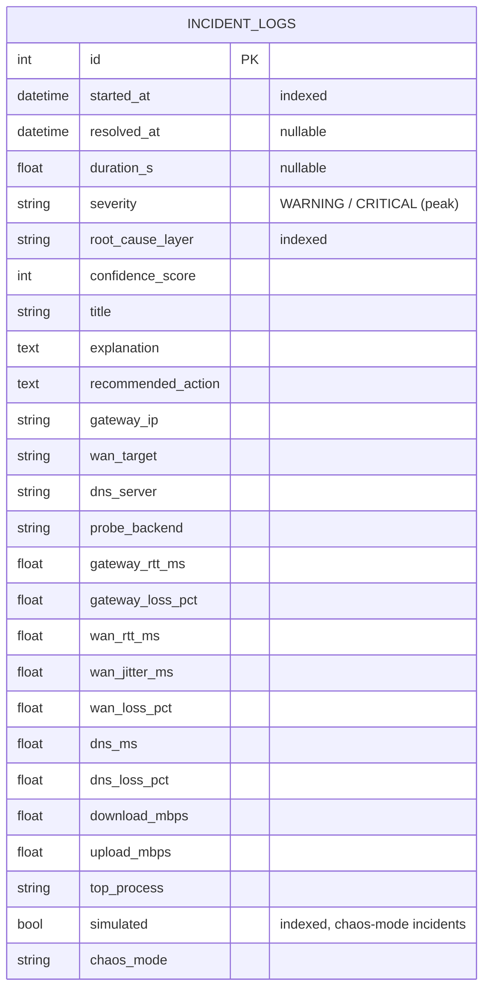

# WiFi-Doctor: Data Flow & Data Model

Drawn from the code: the pipeline in [`backend/app/service.py`](../backend/app/service.py), the probes and analysis in [`backend/app/engine/`](../backend/app/engine/) and the ORM model in [`backend/app/models.py`](../backend/app/models.py). GitHub renders the diagrams directly.

**DFD notation:** rectangles are external entities, numbered rounded boxes are processes, cylinders are data stores.

## DFD Level 0: context diagram

## DFD Level 1

## ERD

WiFi-Doctor keeps live measurements in memory and stores only one kind of record: an **incident**, from the moment a problem is detected until it resolves. It is a single, deliberately denormalized table, so each row is a self-contained piece of evidence (the snapshot of every layer at the time) that can be exported to CSV and sent to an ISP as is.

